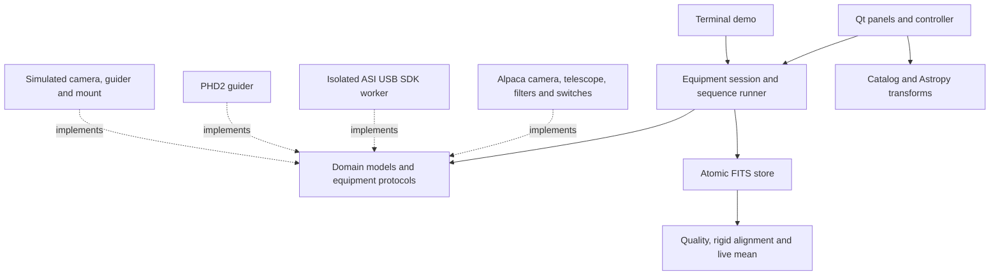

# Architecture

AIO Astro is a Python desktop application. Qt supplies the interface; qasync runs
Qt and asyncio on one event loop. Network adapters use asynchronous I/O; FITS
serialization, coordinate transforms, and display stretches run in worker threads.
No local web server is required.

| Package | Responsibility |
| --- | --- |
| `domain` | Validated models, camera capabilities, errors and equipment protocols |
| `adapters/alpaca` | HTTP, management, discovery, camera settings/capture, telescope, filter and switch operations |
| `adapters/asi` | Native USB ctypes ABI, owned SDK subprocess, bounded calls, camera settings/capture |
| `adapters/eaf.py`, `adapters/eaf_worker.py`, `adapters/alpaca/focuser.py` | Absolute focus movement/readback, native EAF isolation and preserved Alpaca connection ownership |
| `adapters/astap.py` | Local solve CLI, explicit database/search options, bounded diagnostics and process-group cleanup |
| `adapters/phd2.py` | TCP lifecycle, JSON-RPC correlation, event routing and settling |
| `adapters/simulator.py` | Explicitly simulated equipment for development |
| `services` | Equipment ownership, capture orchestration, FITS, profiles, mount pointing policy |
| `services/colour.py`, `services/fits_images.py` | Linear Bayer reconstruction, RGB axes and untouched source mosaics |
| `services/star_quality.py`, `services/registration.py`, `services/live_stack.py` | Star measurements, rigid registration, linear accumulation and atomic stack export |
| `services/solve_images.py`, `services/plate_solving.py`, `sky/solution.py` | Source-preserving solve input, deadlines/provenance/export and celestial WCS validation |
| `services/autofocus.py`, `services/focus_curve.py`, `services/focus_session.py` | Independent focus ownership, matched-star HFR sweep, bracketed convex fit, fresh verification and guarded restoration |
| `services/centering.py`, `sky/pointing_correction.py`, `services/preparation_guiding.py` | Fresh-image identity, bounded offset slews, verification and PHD2 pause/readback/settle |
| `sky` | Catalog/search, proper motions, AltAz/reference-frame transforms and vectorized scenes |
| `data` | Licensed offline HYG/OpenNGC catalogs, constellation and Milky Way assets |
| `gui` | Focused panels, chart rendering, background task ownership and user actions |
| `cli.py` | Desktop startup and a headless simulator workflow |

`Camera`, `Guider`, `Focuser` and `Mount` are structural protocols rather than base classes. A service
can operate with a driver, simulator, or test double without knowing its transport.
There is no premature extension loader, dependency container, or global equipment
registry. Add an interface when a real workflow needs it.

The native ASI adapter loads the vendor SDK only inside an owned subprocess. A
private inherited socket carries bounded JSON requests; SDK stdout/stderr cannot
corrupt this protocol. Original image arrays cross via an owned temporary NumPy
file. Cancellation/timeouts terminate and reap the worker instead of abandoning a
blocked native thread. Writes are never retried. Application callers use the same
Camera contract as Alpaca and Simulator. Readback/cooler capabilities and request
timing remain explicit; no simulated accessory session is created for USB cameras.
See [the ASI guide](ASI_CAMERAS.md) and [runtime preparation](../vendor/zwo/README.md).

## Capture lifecycle

A sequence validates its plan and output directory, optionally starts and settles
guiding, exposes a frame, commits FITS output, and optionally dithers and waits before the
next frame. Progress events carry completed-frame counts and saved paths. A single
runner rejects concurrent runs; a camera also rejects concurrent exposures. The
desktop controller prevents equipment switching while capture is active.

Exceptions stop the sequence and propagate to its caller. Cancellation propagates
through active network waits; the Alpaca camera attempts abort if its driver
supports it. Devices without abort support may continue their current exposure.
Commands whose outcome is unknown are not retried automatically. Camera state is
checked before starting another exposure.

During FITS saving, cancellation waits for the current file to finish its atomic
commit. A unique temporary file is serialized, checksummed and flushed before a
hard link publishes its final name without replacing existing data. The temporary
name is then removed. A failed write removes its temporary file. This assumes an
output filesystem supporting hard links; network shares and exFAT need a future
storage strategy. Filesystem durability under sudden power loss is not guaranteed
by this process alone.

The runner leaves guiding active after capture. The desktop additionally cancels
guided capture when PHD2 reports star loss, stopped/paused guiding, calibration
failure, or disconnection. This event policy belongs to the desktop session; callers
using the standalone runner must supply their own ongoing guiding supervision.

## Protocol boundaries

The Alpaca transport owns request encoding and transaction IDs. GET uses query
parameters; PUT uses form data. Device error envelopes are validated separately
from management responses, which may omit the device error fields. Camera image
arrays swap spatial axes once at the adapter boundary, preserving any native RGB
channel axis. Driver-reported exposure start
and duration take precedence. Only explicit NotImplemented (1024) permits request
timing estimates, recorded with source metadata and FITS HISTORY; download time is
never substituted for exposure start. The mount similarly permits a configured
elevation fallback while preserving driver latitude/longitude.

CameraControls discovers numeric or indexed gain/offset, readout choices, binning
and exposure limits. Optional properties suppress only 1024. Camera settings share
the exposure lock, validate fresh limits, revalidate after readout-mode changes,
and verify readback. Explicit square binning resets and verifies full-frame ROI.
Partial failures are not rolled back or retried: the desktop requires refresh.
Per-frame setting snapshots read actual driver values, independently of form edits.

AccessorySession owns filter/switch connections on the camera server. The small
AlpacaDevice composition preserves connections already owned by other clients;
disconnect never sends heater power or filter-position commands. A filter change
waits for Position to stop reporting -1 and match the destination. Timeouts or
cancellation cannot abort a wheel through this interface; state must be refreshed.
Switch channels use their reported range, step and CanWrite. Binary channels use
SetSwitch; stepped numeric channels use SetSwitchValue and verified readback.

Focused camera/accessory panels and ImagingController reserve operations before
scheduling them. Pending edits, moving filters and unknown setting state prevent
capture, while capture prevents edits/disconnection. A sequence samples filter
position/name before every frame, without continuous external filter supervision.
The inter-frame delay follows saving and any dither, is cancellable, and never
runs after the last frame. It is not a start-to-start cadence scheduler.

PHD2 commands and events arrive on the same connection. A single reader routes RPC
responses to pending futures while updating event observers. Guide/dither installs
its settle future before sending the command, covering an early SettleDone event.
The RPC response and successful settling are both required. A failed or closed
connection fails pending work. Because settle events lack command IDs, a cancelled
or timed-out settle marks the connection as unsuitable for another settle command
until the user reconnects.

## Astronomy boundaries

Targets carry ICRS right ascension in hours and declination in degrees. Observatory
longitude is east positive. AltAz transforms use the requested aware UTC time,
bundled IERS data, and zero atmospheric pressure for a geometric horizon. The chart
is a zenith-centred equidistant projection with east left, with zoom/pan applied as
a presentation transform. HYG ICRS/J2000 positions receive first-order tangential
proper motion for the requested epoch; radial perspective/distance corrections are
omitted. OpenNGC positions are fixed catalog coordinates.

Planned target coordinates are FITS object metadata. They are never represented as
solved WCS or measured mount pointing. Saved-FITS plate solving uses the local
ASTAP adapter, source-preserving image preparation, measured WCS validation and
separate atomic WCS/provenance export. Fresh temporary directories and stripped
input WCS prevent a stale input solution masquerading as a new solve. The adapter
passes explicit database/search arguments, bounds diagnostics, owns its process
group and terminates/reaps on cancellation/deadline. WCS validation uses actual
source geometry, sampled round trips, finite scales, preserved distortions/frame
and ICRS reporting from the centre pixel. A separate chart outline follows chart
site/time; it never becomes mount telemetry or Sync. See
[plate-solving workflow/design](PLATE_SOLVING.md). Fresh capture/solve/centre is a
separate guarded preparation workflow; other solver engines remain future work.

## Mount operations and portable rigs

An independent telescope connection implements the Mount protocol. Alpaca's
CanSlewAsync/CanSync and other capabilities determine available controls. Telescope
state is polled with bounded concurrent property reads; command waits are bounded
and request abort on cancellation/failure. Slew and sync are distinct methods.

MountControl reads a fresh mount state, checks parked/moving status and the target's
actual current altitude at the mount's site, then converts ICRS to its reported
reference frame. Astropy TETE handles equinox-based topocentric apparent RA/Dec;
FK5 handles J2000/J2050 and FK4 handles B1950. Unspecified frames are rejected.
Chart planning time is never passed into hardware commands. Refraction is left to
the driver. Current mount pointing is converted back to ICRS and current AltAz for
the cyan marker, independently of the chart's planning time.

The desktop reserves capture and mount actions before scheduling asynchronous work,
preventing a click-order race. Capture disables mount movement commands; mount
motion prevents capture. Externally reported motion or lost mount state cancels
capture. Abort remains available. These are attended-session interlocks, not a
complete observatory safety controller or mechanical path planner.

Rig profiles store camera and mount connections independently, an optical-tube
label, site, and minimum slew altitude. Loading a profile only edits configuration
while equipment is disconnected. Writes are atomic and a damaged existing profile
file is never silently overwritten. Serial NEQ6 and original network StarBook are
supported through external INDIGO drivers exposed by its Alpaca agent.

## Chart data and rendering

CatalogIndex searches normalized aliases, preferring exact matches. A list model
presents at most 250 results from 132934 objects. SkyController computes complete
snapshots in a worker thread. Scene arrays contain projected objects, reference
lines, constellation labels, and an inverse-projected Milky Way texture. Rendering
only applies viewport transforms and draws those prepared values; it performs no
astronomical transforms or network I/O in paintEvent.

The Milky Way raster derives from five upstream contour levels. The build script
handles winding rings enclosing a celestial pole, RA wrapping, and polygon holes.
Inverse projection avoids artificial edges at the horizon/nadir and preserves the
outline topology. It is a visual layer with 0.25-degree source resolution. Data
versions, checksums, modifications and licenses ship alongside the assets.

## Colour images

ImageFrame.data always holds the captured samples: a 2D monochrome/CFA array or a
native RGB array [height,width,3]. Optional rgb_data holds a derived reconstruction;
display_data selects that or the original. SensorLayout computes the effective
Bayer tile from full-sensor offsets, subframe origin and known 1x1 binning. Unknown
metadata or unsupported sensor layouts remain raw, with a visible description.

The sequence prepares colour in a worker thread. A normalized bilinear 3x3 kernel
reconstructs red/blue, while a cross kernel reconstructs green without smoothing
measured green samples. Normalization uses only available neighbours at boundaries.
The result is floating point without clipping, stretching, white balance or colour
calibration. Numeric precision follows the source dtype; raw values remain intact.
Preview stretching uses one common scale across RGB, and generation IDs prevent
older preview work from replacing a newer image.

FITS colour data is [3,height,width], with explicit RGB plane labels. A derived
primary image has DEBAYER/CFAORIG provenance and a RAW extension with the untouched
sensor mosaic and independent checksum. Native RGB needs no duplicate RAW extension.
Raw-only output remains a single 2D primary image. Raw CFA BAYERPAT is normalized
to the first stored pixel, with zero residual offsets; original ASCOM offsets and
ROI origin are recorded separately, avoiding accidental double application.
ROWORDER records the stored top-down convention. No astrometric WCS is invented.
Calibration should use raw sensor samples before reconstruction.

## Live stack lifecycle

Only committed capture events feed LiveStackController. It owns one running frame
and one queued frame; excess frames are labelled skipped while originals remain
saved. A generation counter isolates old work after New stack. Thread work is
drained before cancellation completes. Qt widgets edit rules and render results;
domain rules and quality/registration/accumulation/export services never import Qt.

Star measurements use the original linear image; a separate mean-bin scale limits
working-array size. Rigid star registration uses explicit source/working pixel
centre mapping, interpolation masks and per-pixel coverage. A locked accumulator
serializes additions and export, using float64 sums and float32 derived means.
The first accepted frame fixes identity/settings/geometry and reference stars;
incompatible frames are rejected with a reason. Rule changes affect future frames.
Exports preserve simulation/timing provenance, coverage and bounded decision logs,
using atomic no-replace FITS publication. Source mosaics/files remain untouched.
See [the Live Stack guide](LIVE_STACK.md) for supported transforms and limits.

## Capture preparation

The GUI reserves camera/settings, mount and focuser before scheduling standalone
autofocus/centring or optional sequence preparation. FocusSession owns its endpoint
independently of the camera; Seestar defaults only select an advertised candidate
without automatically opening/moving it. PreparationController composes autofocus,
centring and actual PHD2 pause/readback/resume while SequenceRunner retains normal
science capture and SettleDone behavior. Failure prevents science capture.

Preparation capture reuses the normal atomic FITS pipeline, retaining RAW, colour,
timing and filter provenance with explicit OBSPURP/FOCPOS. Only SCIENCE committed
events enter live stacking. Autofocus fixes a matched star cohort before fitting,
rejects unbracketed/flat/nonconvex/poor fits and verifies a fresh image at the fitted
position. Optical rejection may restore a known healthy start; transport failure
or cancellation never causes a blind position restore. EAF uses the existing
private SDK subprocess transport with its own worker module/label and deadline.

Centring binds results to fresh source bytes and geometry. Reported mount pointing
is rotated by measured-to-desired displacement, transformed to the current mount
frame at actual UTC, then sent as a bounded slew; another exposure verifies it.
No automatic Sync modifies mount alignment. See [focusing](FOCUSING.md) and
[plate solving](PLATE_SOLVING.md) for limits and separate physical validation.
