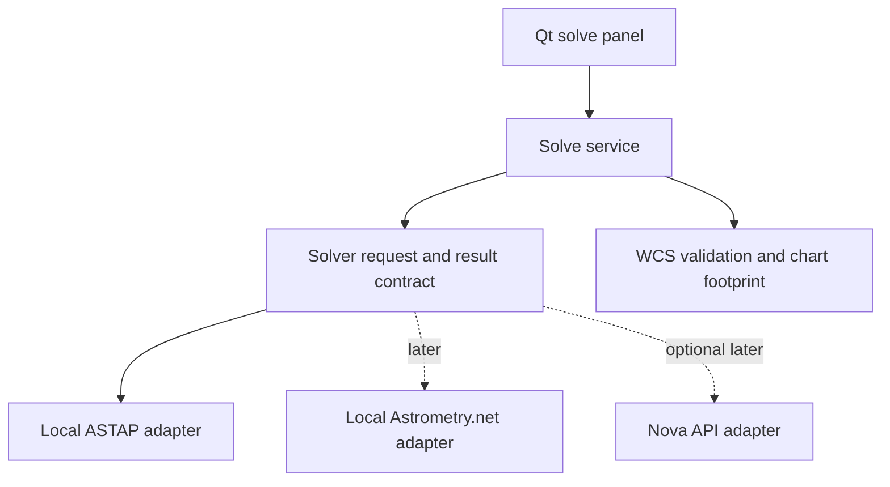

# Plate solving: setup, workflow and design

Status: **saved-FITS offline ASTAP solving implemented in 0.6.0**, 2026-10-21.
The desktop includes a Plate solving tab, validated measured results, a chart
outline and separate WCS/provenance export. A separate fresh capture/solve/centre
workflow is available from Capture; physical centring validation, other solver
engines and signed packaging remain future work.

## Use the desktop workflow

1. Restart AIO Astro after updating. Open **Plate solving**, or **File → Plate solve
   FITS…**, and choose an existing FITS. **Use latest saved capture** selects the
   last completed capture in this session. Set **Image HDU** to 0 for primary data
   or the desired image extension's index.
2. Confirm the ASTAP executable/database folder. The prepared source checkout
   fills these automatically. Select **D80** for image heights 0.15–6 degrees or
   **G05** for 3–20 degrees; all tiles must be present in its selected folder.
3. Enter **image height in degrees**, or click **Read FITS search hints**. The
   button uses celestial WCS when present. Recognized Seestar exports instead
   supply RA/DEC in degrees and an optical height estimate from image dimensions,
   focal length and the already-binned pixel pitch. Their undeclared coordinate
   frame is displayed explicitly; review these approximate search values.
   The solver input has no copied WCS.
4. Optionally enable **Use approximate pointing**, entering RA in hours and
   declination in degrees, with an adequate search radius. Without a position hint,
   ASTAP searches the sky at the entered height; this may hit the deadline.
   The DSS trial without a position hint reached its 120-second deadline; use
   an approximate pointing estimate for the initial workflow.
   Automatic searches across unknown field heights are not implemented.
5. Click **Solve locally**. **Cancel solve** stops the owned ASTAP process group.
   The total deadline includes preparation, input hashing and WCS validation.
   Finite file work is drained before temporary files are removed.
6. Inspect the measured ICRS centre, X/Y arcsec-per-pixel scales, field size,
   positive-Y position angle (east of celestial north), parity determinant sign,
   backend/database and warnings. **Show measured field in Sky view** focuses an
   orange outline projected at the chart's site/time, enabling below-horizon view
   if necessary. This is a historical image footprint, separate from Mount now.
7. **Save WCS solution…** creates a separate FITS-format `.wcs` file without
   replacing existing files. Its header-only primary holds celestial WCS including
   distortion/reference frame. IMAGEW/IMAGEH identify source dimensions;
   PROVENANCE stores JSON with source/HDU/SHA-256, executable/database hashes,
   search options, elapsed time, intensity method and bounded diagnostics.

For an optical estimate, image height ≈ `height_pixels × 206.265 × pixel_pitch_µm
× vertical_camera_bin / focal_length_mm / 3600` degrees. Use actual ROI dimensions
and optical parameters, not a camera-name guess. For example, 4176 pixels at
3.76 µm and 1× binning with a 1000 mm focal length gives about 0.90 degrees.

Mono/2D intensity, labelled RGB FITS planes (`RGBORDER=RGB`) and known unbinned
2×2 Bayer layouts are supported. RGB becomes a linear arithmetic-mean detection
image. Complete CFA phase metadata allows linear reconstruction first. Seestar
exports can omit phase-offset tags: these use symmetric 3×3 binomial intensity
smoothing for detection only, without debayering, assigning colour planes or
inventing missing metadata. The smoothing preserves source pixel centres and
dimensions. Unknown/binned raw layouts, ambiguous cubes, non-image HDUs and
non-finite data receive an actionable error. Detection intensity keeps source
pixel dimensions/origin; ASTAP
downsampling is internal and its WCS must describe source pixels. Display-stretched
previews are never input. Source FITS samples, RAW extensions and checksums stay
untouched. Simulator fields are generated and cannot be expected to solve.

## Prepare offline assets

```sh
uv run python scripts/prepare_plate_solving.py
# With all pinned archives cached:
uv run python scripts/prepare_plate_solving.py --offline
```

This verifies the downloaded inputs, extracts and locally signs separate Mac
arm64/x86_64 command-line executables, and selects only D80/G05 star tiles.
It runs no package installer or hardware commands. Existing archives stay
unchanged. No solver operation requires internet. The runtime is under
`vendor/astap/downloads/runtime`; the executable and database selectors also allow
an installed wheel to use separately prepared assets. See
[native assets, credits and future distribution requirements](../vendor/astap/README.md).

## Verification and limits

Local process peers test units/options, successful/failing/missing/malformed
outputs, bounded diagnostic draining, source identity/preservation and cancellation
of a solver with an uncooperative child. Analytic WCS cases cover pixel-centre
versus CRVAL, parity/rotation, RA wrap, polar fields, SIP distortion and FK5-to-ICRS.
Qt tests cover opening a file, explicit search hints, solve/export, invalidation,
failure recovery and the independent chart footprint, without connected equipment.

Real Apple Silicon ASTAP 2026.09.01 trials solved a DSS star field plus derived
RGB/mirrored/rotated and explicit 2× solver-downsample inputs while **macOS denied
network access**. Measured centres differed from the independent DSS WCS by
0.32–0.47 arcsec; hinted solves took about
0.8–1.5 seconds on this Mac. This is a real-image software check, not a guarantee
for every image or evidence of physical camera/mount validation. Intel was
prepared but not executed. Additional optical setups/ROI/binning fields need
further trials. Match residuals/star counts are not displayed unless supplied and
validated by a future backend extension.

With the user's permission, 12 original Seestar S30 Pro frames across C27,
IC1805, IC1848 and M31 were subsequently tested: 12 D80 solves and 4 G05 solves
all passed with network access denied (about 0.34–1.51 s including preparation).
Every original's before/after SHA-256 matched. A real-file Qt trial also passed
header hints, solve, WCS export and chart footprint. These validate saved Seestar
files; they do not validate hardware capture or automatic mount centring. Header
pointing is approximate, so it is not an independent accuracy ground truth.
Private images and their detailed validation reports remain outside source/wheel
distribution.

The cached test image is Astropy's
[HorseHead.fits](https://github.com/astropy/astropy-data/blob/gh-pages/tutorials/FITS-images/HorseHead.fits),
SHA-256 `c4bcc0bccbadf1488e4e361c0d8f04255dc344ff401fd4827139b3354eafe863`.
It is a STScI/MAST Digitized Sky Survey scan of a UK Schmidt/SERC-ER photographic
plate; its header names **AAO/ROE** as copyright holder. This downloaded trial
fixture remains outside the wheel/source distribution; no new redistribution
licence is asserted. Fetch from the raw download link into
`vendor/astap/downloads/horsehead-astropy.fits` to repeat opt-in trials:

```sh
AIO_ASTAP_REAL_TEST=1 uv run pytest tests/test_astap_real.py -q -s
```

The ordinary suite needs only local peers and never downloads data or runs the
cached native binary. The following sections describe the implementation and
broader direction; online fallback remains a future workflow.

## Recommendation

Solving works locally by default through the ASTAP process adapter and saved
FITS images. Keep the Astrometry.net web API as a later, optional fallback.
Local Astrometry.net is another possible adapter if image trials justify it.
Keep one small solver contract rather than building a plugin framework or writing
another star-pattern matcher.

| Option | Internet during a solve | Proposed role |
| --- | --- | --- |
| ASTAP executable and local star database | No | Implemented saved-FITS engine |
| Astrometry.net `solve-field` and local indexes | No | Alternative local engine after benchmarking |
| Nova Astrometry.net API | Yes | Explicitly enabled remote fallback |

The Astrometry.net project supplies both a web API and a local solver. Local index
selection depends on image angular scale; it does not require running a private
web server. See the [local solver documentation](https://astrometry.net/doc/readme.html)
and [installation documentation](https://astrometry.net/doc/build.html).

[ASTAP's documentation](https://www.hnsky.org/astap.htm) lists Intel and Apple Silicon
Mac builds, including command-line versions, plus local star databases. It also
describes signing requirements on Apple Silicon. Start with a configured external
executable and database directory. Bundling them into a signed AIO Astro release
is a separate distribution task, including version pinning and notices for the
actual software and datasets shipped.

## Offline preparation and first workflow

Install the solver and suitable reference data while a connection is available,
or import them from local media. Before a field session, check the executable can
run and the selected database exists and covers the intended image scales. Show
missing components and their remedy, rather than an indefinitely spinning Solve
button. Solving still depends on adequate stars, focus and image quality.

Select reference data using each optical setup's field of view. Store focal length
in mm and pixel sizes in micrometres when known, with actual binning and image
dimensions. These are estimates for the search, not measured calibration. Do not
guess missing optical properties from a camera name or silently apply settings
when loading a profile. The bundled chart catalog is not a replacement for a
solver's reference database. Download sizes and coverage should be shown for the
specific selected dataset rather than promising one size for every setup.

The first desktop workflow needs no connected equipment:

1. Open an existing light-frame FITS file or select a completed capture.
2. Solve locally with a visible deadline and Cancel action.
3. Display measured centre RA/Dec, scale in arcsec/pixel, field dimensions and
   image orientation, with the solver and data provenance.
4. Draw the measured field footprint on the chart and optionally save a WCS
   sidecar associated with the source image. Keep the original capture unchanged.

This supports testing during cloudy weather using previously captured images.
A separate fresh Capture, Solve and Centre operation now uses the existing
camera ownership and settings interlocks, described below.

## Boundaries and result integrity



Keep requests and results in `domain`, transport/process details in `adapters`,
orchestration and persistence in `services`, celestial transforms in `sky`, and
widgets/task ownership in `gui`. Domain and services remain independent of Qt.

A request identifies the source image, selected image HDU, original dimensions,
optional pointing/scale estimates with explicit units and provenance, and a total
deadline. A result identifies that same source and geometry, the celestial WCS,
normalised ICRS centre, backend/version, reference data identity, elapsed time and
warnings. Report fit residuals or match counts only when actually supplied.

Validate the returned WCS with [Astropy WCS](https://docs.astropy.org/en/stable/wcs/index.html).
Require finite, non-degenerate transforms, sensible scales and pixel/sky round trips
at the centre and sampled image edges. Obtain the image centre by transforming
its centre pixel; CRVAL need not describe that pixel. Preserve projection,
distortion and reference-frame information. Normalise pixel-origin conventions,
axis order, parity and any working-image transforms exactly once. Late results
must not replace a newer image's result. Planned target coordinates and mount
telemetry are search hints, never proof of a successful solve.

## Image preservation and execution policy

- Prepare a temporary 2D linear solve image, preserving its mapping to the source.
  RGB FITS planes are `[plane,row,column]`; internal RGB is `[row,column,RGB]`.
  A documented linear channel combination can supply detection intensity.
  CFA reconstruction must follow the existing known-layout/binning/ROI rules;
  never guess an unknown Bayer pattern or use the stretched preview as source.
- Leave scientific pixels, the original RAW extension, exposure timing provenance
  and existing checksums intact. Begin with separate solution files; a future
  solved-copy export must preserve samples and recompute its own checksums.
- Launch subprocesses asynchronously with argument lists, a private work directory,
  bounded diagnostic output, and an overall wall-clock deadline. On cancellation
  or timeout, terminate and reap the process and any owned child processes, with
  a bounded kill escalation. Clean temporary files after execution has ended.
- ASTAP must receive explicit paths and search parameters, request FITS-format WCS
  output with `-wcs`, and omit `-update`. Its RA argument is in hours, south-pole
  distance is declination + 90 degrees, and FOV means image height in degrees.
  Avoid depending on settings learned by a separate ASTAP GUI session. Treat
  missing/corrupt data, too few stars, no match, timeout and cancellation distinctly.
- Try a bounded search using available position/scale estimates; permit a broader
  local search within the total budget. Validate a blind-search mode against the
  actual backend's supported field scales before offering it. Cancelling a local
  solve must never trigger another backend or upload.

The later [Nova adapter](https://astrometry.net/doc/net/api.html) would authenticate
with an API key, submit an image, poll submission/job state and retrieve its WCS.
It must require an explicit remote-solving preference, show upload/licensing
choices, protect credentials and use HTTPS. HTTP deadlines and bounded polling
share a total operation budget. Cancellation stops local waits; it must not claim
to cancel an already submitted server job. Connectivity detection alone is not
permission to upload, and a failed upload must not silently create duplicate jobs.

## Fresh capture and centre

Solving measures an image and sends no mount command. Retain the existing manual
Sync meaning: the user has centred the selected target before requesting Sync.
Do not turn a solved image or imported historical capture into an automatic Sync.

The **Capture, solve and centre target** action in Capture, and the optional
pre-sequence checkbox, implement a separate capture/solve/correct/verify workflow.
Choose the intended target in Sky view, connect a stationary tracking mount and
camera, and configure ASTAP/local data and image height in Plate solving. The
centring options there default to 2 s pointing exposures, 30 arcsec tolerance,
at most three corrections, a 2 degree maximum correction and 2 s settle time.

Only the newly saved exposure can drive a correction: path, source hash, HDU,
geometry, simulation state, request identity, timestamp and age are checked.
Mount frame/site and reported pointing must stay stable throughout capture/solve.
Each bounded spherical offset rotates reported ICRS pointing by the displacement
from measured field to desired target; a fresh frame then independently verifies
the result. Stop on failed solving, oversized offsets, divergence or the iteration
limit. No write is retried and no Sync or alignment-model edit is sent.

Hardware coordinates and target/correction altitude checks use actual current UTC
and the mount's current frame/site, independently of chart planning time. Capture,
settings and manual motion are interlocked; Abort/Cancel interrupts preparation.
Every pointing FITS (`OBSPURP=CENTERING`) and separate WCS/provenance sidecar stays
in the unique `preparation/` run directory. These images do not feed Live Stack.
Optional autofocus runs first. PHD2 is fully paused/read back before preparation
and successful SettleDone is required when guiding resumes; failed preparation
leaves application-paused guiding paused with an explicit message.

Generated simulator stars do not match ASTAP's celestial catalog. Automated
centring trials use labelled solver/device peers; saved real Seestar solves test
the solver without moving a telescope. Physical centring remains to validate.

## Further acceptance and development order

1. The local ASTAP adapter, WCS validation, saved-FITS service and desktop workflow
   are implemented, including process-peer cancellation/deadline/output tests.
2. Extend real offline trials beyond the credited DSS field: Seestar/ASI RGB/CFA,
   additional optical scales, ROI/binning and downsampling mappings. Keep network
   access blocked for offline acceptance.
   Existing simulator images must not be assumed to be solvable catalog fields;
   generated fixtures and simulated results must remain visibly identified.
3. Validate Intel execution and clean-machine setup/packaging of solver/data.
4. Capture/solve/centre is implemented with peer tests; validate attended physical
   centring, correction sign and convergence on each supported mount/optical setup.
5. Benchmark a local Astrometry.net alternative and add optional Nova support only
   when useful. Use mock HTTP transports for API lifecycle/fault tests; report real
   remote solves separately.

All implementation stages require Ruff lint/format checks and relevant tests.
No performance, embedded distribution or hardware compatibility claim should
precede a measured trial on the supported Mac and image types.
